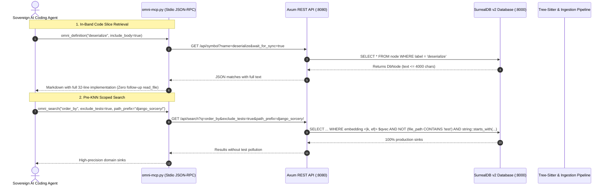

# 🛠️ Omni-Graph Engineering Spec: Agent DX & Forensic Auditing Suite

> **Document ID**: `SPEC-OMNI-006`  
> **Status**: `spec-review`  
> **Target Version**: `v0.8.0`  
> **Author**: Antigravity (Google DeepMind) & `@vadde`  
> **Date**: 2026-11-06  
> **Companion PRD**: [`specs/catalog/omni-graph-agent-dx-prd.md`](omni-graph-agent-dx-prd.md)  
> **Precedence**: Extends [`specs/catalog/omni-graph.md`](omni-graph.md), [`specs/catalog/omni-graph-ai-native-galaxy-cosmology.md`](omni-graph-ai-native-galaxy-cosmology.md), and [`specs/catalog/omni-graph-live-watcher-fidelity-parity.md`](omni-graph-live-watcher-fidelity-parity.md).

---

## 1. Executive Summary & Epistemic Boundary

### 1.1 The Epistemic Flaw of Blind Truncation & Import-Centric Labels
During a forensic security audit of `django-sorcery`, Omni-Graph demonstrated unprecedented efficiency in topology traversal and sink discovery. However, two fundamental architectural oversights degraded agent velocity:
1. **The Round-Trip Tax**: The MCP protocol bridge (`omni-mcp.py`) blindly truncated `m.get('text')` to 400 characters, while the backend AST parser clamped stored node text to 1,000 characters. For functions between 30 and 100 lines (e.g. `deserialize`), this forced the agent into a compulsory two-step round-trip: first call `omni_definition`, then call `read_file`.
2. **Centroid Election Degradation**: In `analysis/mod.rs`, cluster naming naively assigned the first node's label in iteration order. In Python codebases with barrel imports, import AST nodes (`from ...fields import ...`) frequently appeared first, labeling entire subsystems after transient import statements rather than the core domain models.

This specification provides the formal mathematical models, AST grammar modifications, database queries, and MCP interfaces to permanently resolve these bottlenecks.

---

## 2. Requirements & Traceability Matrix

### 2.1 Functional Requirements (R-110 to R-117)

| Master ID | Feature ID | Requirement Title | Architectural Domain | Priority |
| :--- | :--- | :--- | :--- | :--- |
| **R-110** | `R-OG-DX-01` | **In-Band AST Code Slices & Adaptive Body Budgeting** | MCP Bridge, AST Parser (`parser/mod.rs`) | 🔴 Must |
| **R-111** | `R-OG-DX-02` | **Semantic Kind-Weighted Galaxy Centroid Election** | Graph Analysis (`analysis/mod.rs`) | 🔴 Must |
| **R-112** | `R-OG-DX-03` | **Pre-KNN Scoped Filtering in Vector Search (`exclude_tests`, `path_prefix`)** | SurrealDB v2 HNSW Query, API | 🔴 Must |
| **R-113** | `R-OG-DX-04` | **Qualified Symbol & Containment Traversal (`Class.method`, `path:symbol`)** | SurrealQL Graph Query, DB Client | 🟡 Should |
| **R-114** | `R-OG-DX-05` | **Python Class Inheritance & Metaclass DAG Extraction (`EXTENDS`, `METACLASS_OF`)** | Tree-Sitter Python Ingest Parser | 🟡 Should |
| **R-115** | `R-OG-DX-06` | **Python Import Alias Resolution in Symbol Table** | SAIR Ingestion (`symbol_table.rs`) | 🟡 Should |
| **R-116** | `R-OG-DX-07` | **Dynamic Reflection & Metaprogramming Heuristic Flagging (`has_reflection`)** | AST Parser, Schema, MCP | 🟢 Could |
| **R-117** | `R-OG-DX-08` | **Multi-Workspace MCP Parity & Tool Schema Synchronization** | Stdio MCP Server, Agent Skills | 🔴 Must |

### 2.2 Acceptance Criteria (AC-037 to AC-044)

| AC ID | Target Requirement | Description & Grounded Verification Criteria |
| :--- | :--- | :--- |
| **AC-037** | R-110 | Calling `omni_definition("deserialize", workspace="django-sorcery")` returns the complete 32-line function body in markdown code fences without truncation. |
| **AC-038** | R-110 | If a query returns $> 3$ matches (e.g., bare symbol `get`), individual bodies are truncated at 400 chars with an explicit notice unless `force_full_bodies: true` is passed. |
| **AC-039** | R-111 | In `django-sorcery`, running `omni_galaxies()` produces zero titles starting with `from ` or `import `, correctly renaming Galaxy #10 from `from ...fields import ...` to `django_sorcery/fields (ModelChoiceField)`. |
| **AC-040** | R-112 | Calling `omni_search("order_by", exclude_tests=true, workspace="django-sorcery")` returns 0 results from `tests/`, reserving the entire top-$k$ window for `django_sorcery/db/query.py`. |
| **AC-041** | R-113 | Calling `omni_definition("Query.order_by", workspace="django-sorcery")` resolves precisely to the method on `Query` with enclosing context displayed: `• [method] Query.order_by`. |
| **AC-042** | R-114 | Calling `omni_references("RelationsMixin", workspace="django-sorcery")` lists `SQLAlchemy` under `Inheritance & Interfaces` via `EXTENDS`. Metaclass `_sqla_meta` emits `METACLASS_OF`. |
| **AC-043** | R-115 | Aliased imports (`from foo import Bar as Baz`) allow references to `Baz` to correctly resolve to `Bar` in `symbol_table.rs`. |
| **AC-044** | R-116 | Methods utilizing `setattr` or `getattr` are tagged with `has_reflection: true` in the DB and render `[⚠️ reflection]` in MCP responses. |

### 2.3 Non-Functional Requirements (NF-019 to NF-021)

- **NF-019 (Backward Compatibility)**: Existing agent prompts omitting new flags must continue functioning identically with zero breaking schema errors.
- **NF-020 (KNN Query Performance)**: The parameterized SurrealQL `WHERE` filter must execute under 50ms on a 50,000-node graph using native HNSW index operators.
- **NF-021 (RAM Overhead Containment)**: Expanding AST node text storage to 4,000 characters must increase database disk footprint by $< 15\%$ across all 11 indexed codebases.

---

## 3. Detailed Architectural Design

### 3.1 Architecture Overview & Call Flow



---

## 4. Algorithmic & Subsystem Specifications

### 4.1 In-Band Code Slices & Adaptive Budgeting (R-110)

#### 4.1.1 Storage Ceiling Expansion in Rust AST Parser
In `tools/omni-graph/src/parser/mod.rs`, `Self::safe_truncate(snippet, 1000)` clamps node text to 1,000 characters. This is upgraded:

```rust
// Increase AST node text storage ceiling to 4000 characters (R-110)
// Accommodates ~100-120 lines of code for complete in-band verification
pub const MAX_AST_NODE_TEXT_CHARS: usize = 4000;

let text = Self::safe_truncate(snippet, MAX_AST_NODE_TEXT_CHARS);
```

#### 4.1.2 Adaptive MCP Response Budgeting
In `scripts/omni-mcp.py`:
1. If `include_body` is `True` (default):
   - For single match (`len(matches) == 1`): If line count $\le 120$ and char count $\le 3,500$, emit the complete code body.
   - For multiple matches ($2 \le \text{count} \le 3$): If each match $\le 60$ lines, emit full bodies.
   - For ambiguous queries ($\text{count} > 3$): To prevent context blowup, emit signatures and line bounds with a 300-char preview, appending: `[truncated: use qualified name or read_file for full body]`.
   - Caller override: `force_full_bodies: bool = false` forces full bodies regardless of match count.

---

### 4.2 Semantic Kind-Weighted Centroid Election (R-111)

#### 4.2.1 Mathematical Centroid Scoring Function
In `tools/omni-graph/src/analysis/mod.rs`, `compute_galaxy_metrics` currently takes `top_symbols.first()`. This is replaced with a **Semantic Kind Weighting** algorithm:

$$\text{Score}(n) = \text{KindWeight}(n.\text{kind}) \cdot \left(1 + \ln(1 + \text{InDegree}(n))\right)$$

Where:
$$\text{KindWeight}(k) = \begin{cases} 
100 & \text{if } k \in \{\text{"class"}, \text{"struct"}, \text{"interface"}, \text{"trait"}\} \\
75 & \text{if } k \in \{\text{"function"}, \text{"fn"}\} \\
50 & \text{if } k \in \{\text{"method"}\} \\
20 & \text{if } k \in \{\text{"constant"}, \text{"enum"}\} \\
0 & \text{if } k \in \{\text{"import"}, \text{"import_from"}, \text{"file"}, \text{"directory"}, \text{"workspace"}, \text{"section"}, \text{"manifest"}\}
\end{cases}$$

#### 4.2.2 Centroid Label Sanitization Filter
Any symbol meeting ANY of the following rejection predicates MUST be excluded from centroid candidacy:
1. `n.kind` matches any zero-weight kind.
2. `n.label.contains('\n')` (multi-line import statement block).
3. `n.label.starts_with("from ")` or `n.label.starts_with("import ")`.
4. `n.label.starts_with('.')` (hidden file or dot-config).
5. `n.label.trim().is_empty()`.

If all members of a cluster are rejected (e.g. documentation-only cluster), the cluster name falls back to:
$$\text{ClusterName} = \text{DominantDirectory} \text{ or } \text{CleanBasename}$$

---

### 4.3 Pre-KNN Scoped Search Filtering (R-112)

#### 4.3.1 Axum REST Parameter Contract
```rust
#[derive(Deserialize)]
pub struct SearchParams {
    #[serde(alias = "query")]
    pub q: String,
    #[serde(alias = "limit")]
    pub k: Option<usize>,
    pub workspace: Option<String>,
    pub include_docs: Option<bool>,
    #[serde(default)]
    pub exclude_tests: Option<bool>,
    #[serde(default)]
    pub path_prefix: Option<String>,
    #[serde(default)]
    pub wait_for_sync: Option<bool>,
    #[serde(default)]
    pub timeout_ms: Option<u64>,
}
```

#### 4.3.2 SurrealQL Query Formulation
In `tools/omni-graph/src/db/mod.rs`:
```surql
LET $qvec = [...];
SELECT id, workspace, label, kind, file_path, language, text, community, line_start, line_end,
       vector::similarity::cosine(embedding, $qvec) AS similarity
FROM node
WHERE workspace = $ws
  AND kind NOT IN ['workspace', 'directory']
  AND language != 'markdown'
  /* Pre-KNN Test Exclusion (R-112) */
  AND NOT (
      file_path CONTAINS '/test/' OR
      file_path CONTAINS '/tests/' OR
      file_path CONTAINS 'test_' OR
      file_path CONTAINS '_test.' OR
      file_path CONTAINS '/spec/'
  )
  /* Path Prefix Scoping (R-112) */
  AND string::starts_with(file_path, $path_prefix)
  /* Native HNSW KNN Operator */
  AND embedding <|10, 40|> $qvec
ORDER BY similarity DESC
LIMIT 10;
```

---

### 4.4 Qualified Symbol Resolution (R-113)

#### 4.4.1 Dot-Separated and Path-Separated Parsing
When `GET /api/symbol?name=...` receives an identifier:
1. **Case A (Path Qualified)**: Contains `:` (e.g., `django_sorcery/db/query.py:order_by`):
   - Split into `(path_filter, symbol_name)`.
   - Execute query with `label = symbol_name AND string::ends_with(file_path, path_filter)`.
2. **Case B (Class/Receiver Qualified)**: Contains `.` (e.g., `Query.order_by`):
   - Split into `(parent_type, method_name)`.
   - Query:
     ```surql
     LET $parent_nodes = (SELECT VALUE id FROM node WHERE workspace = $ws AND label = $parent_type);
     SELECT id, workspace, label, kind, file_path, language, line_start, line_end, text, community,
            (label = $method_name) AS is_exact
     FROM node
     WHERE workspace = $ws
       AND label = $method_name
       AND (
           <-linked_to[WHERE type = 'CONTAINS'].in IN $parent_nodes
           OR file_path IN (SELECT VALUE file_path FROM node WHERE id IN $parent_nodes)
       )
     ORDER BY is_exact DESC LIMIT 25;
     ```
3. **Case C (Bare Identifier)**: Retains existing high-speed lookup with exact-match ordering.

#### 4.4.2 Header Decoration in MCP
If the resolved symbol has an inbound `CONTAINS` edge from a parent class or struct, decorate the response header:
`• [method] Query.order_by in django_sorcery/db/query.py:69-95 (python)`

---

### 4.5 Python Class Inheritance & Metaclass Graph DAG (R-114, R-115)

#### 4.5.1 Metaclass & Positional Extraction in `parser/mod.rs`
```rust
// Tree-Sitter Python class definition parsing
if kind == "class_definition" && language == "python" {
    if let Some(superclasses) = node.child_by_field_name("superclasses") {
        let mut s_cursor = superclasses.walk();
        for child in superclasses.children(&mut s_cursor) {
            let c_kind = child.kind();
            if c_kind == "identifier" || c_kind == "attribute" {
                let base_name = &content[child.byte_range()];
                let clean_base = base_name.rsplit('.').next().unwrap_or(base_name).trim();
                if !clean_base.is_empty() {
                    edges.push(ExtractedEdge {
                        workspace: workspace.to_string(),
                        source_id: id.clone(),
                        target_label: clean_base.to_string(),
                        target_id: None,
                        edge_type: "EXTENDS".to_string(),
                        category: "EXTRACTED".to_string(),
                    });
                }
            } else if c_kind == "keyword_argument" {
                // Extract metaclass=_sqla_meta (R-114)
                if let (Some(k), Some(v)) = (child.child_by_field_name("name"), child.child_by_field_name("value")) {
                    let k_str = &content[k.byte_range()];
                    if k_str == "metaclass" {
                        let meta_val = &content[v.byte_range()];
                        let clean_meta = meta_val.rsplit('.').next().unwrap_or(meta_val).trim();
                        edges.push(ExtractedEdge {
                            workspace: workspace.to_string(),
                            source_id: id.clone(),
                            target_label: clean_meta.to_string(),
                            target_id: None,
                            edge_type: "METACLASS_OF".to_string(),
                            category: "EXTRACTED".to_string(),
                        });
                    }
                }
            }
        }
    }
}
```

#### 4.5.2 Import Alias Resolution in `extract_imported_symbols`
For Python statements like `from django.forms.models import BaseModelForm as DjangoBaseModelForm`:
- In `extract_imported_symbols`, parse `as <alias>`.
- Register BOTH `BaseModelForm` and `DjangoBaseModelForm` into `SymbolTable.file_imports`.
- When `class MyForm(DjangoBaseModelForm)` is resolved in Pass 2, `symbol_table.rs` matches `DjangoBaseModelForm` via Tier 2 explicit import resolution.

---

### 4.6 Dynamic Reflection Heuristic Flags (R-116)

In `src/parser/mod.rs`:
During function AST traversal, maintain a boolean flag `has_reflection`:
- In Python: Detect identifier calls to `getattr`, `setattr`, `hasattr`, `delattr`, `eval`, `exec`, `__import__`, `import_module`, or `importlib`.
- In Rust/Go: Detect dynamic `transmute`, `Any`, `reflect.ValueOf`.
- Persist `has_reflection: bool` in `ExtractedNode` and SurrealDB schema.

---

## 5. Anti-Yes-Man Architectural Sparring & Trade-Off Analysis

| Architectural Decision | Option A (Naive Proposal) | Option B (Engineered Solution) | Pros & Cons / Trade-off Rationale |
| :--- | :--- | :--- | :--- |
| **In-Band Code Slices** | Unconditionally dump 100% of symbol text for every match. | Adaptive budgeting: full body if $\le 120$ lines and $\le 3$ matches; clamp to signature if $> 3$ matches. | **Blast Radius**: Unconditional dumping on bare symbols like `get` or `__init__` (matching 25+ files) would inject 3,000+ lines into agent context, causing context bloat and token exhaustion. Option B preserves context discipline while eliminating round-trips for target lookups. |
| **Search Filtering** | Filter top-$k$ results in Rust after SurrealDB query returns. | Push `WHERE` predicates natively into the SurrealQL HNSW KNN query. | **Correctness Bound**: If 7 of top-10 are test mocks, post-filtering leaves only 3 results to the agent! Pushing into the DB query guarantees the full $k=10$ window is filled with production sinks. |
| **Galaxy Centroid Election** | Simple degree centrality among all nodes. | Semantic kind ranking (Classes > Functions > Methods) with hard zero-weight exclusion of imports. | **Architectural Truth**: Barrel files and shared utilities have massive degree due to re-exports, but near-zero conceptual domain meaning. Semantic kind ranking surfaces actual bounded contexts. |

---

## 6. Verification & Test Plan

### 6.1 Unit Tests (`tests/unit_tests.rs`)
1. `test_r110_in_band_body_budgeting_single_vs_multi_match`: Asserts body inclusion threshold $\le 120$ lines and clamp on $> 3$ matches.
2. `test_r111_centroid_election_excludes_imports_and_newlines`: Verifies a cluster with 50 import nodes and 1 class elects the class as primary symbol.
3. `test_r112_scoped_vector_search_sql_generation`: Asserts SurrealQL query formulation contains `NOT (file_path CONTAINS 'test')` and `string::starts_with`.
4. `test_r113_qualified_symbol_parsing`: Verifies `Query.order_by` and `path/to/file.py:order_by` parsing and containment traversal.
5. `test_r114_python_metaclass_and_extends_extraction`: Parses Python class with multiple bases and `metaclass=...`, verifying `EXTENDS` and `METACLASS_OF` edge emission.
6. `test_r115_python_import_alias_resolution`: Parses `from a import b as c`, verifying both symbols are registered.
7. `test_r116_reflection_flagging`: Parses functions with `setattr` and `getattr`, verifying `has_reflection == true`.

### 6.2 Empirical Grounded Verification on `django-sorcery`
- Run `cargo test --test unit_tests` (verify 122+ green tests).
- Re-index `django-sorcery`.
- Call `omni_definition("deserialize", workspace="django-sorcery")` $\to$ verify 32-line full body output in 1 turn.
- Call `omni_galaxies(workspace="django-sorcery")` $\to$ verify zero `from ...` galaxy labels.
- Call `omni_search("order_by", exclude_tests=true, workspace="django-sorcery")` $\to$ verify 0 test files returned.
- Call `omni_definition("Query.order_by", workspace="django-sorcery")` $\to$ verify exact method resolution.
- Call `omni_references("RelationsMixin", workspace="django-sorcery")` $\to$ verify `SQLAlchemy` under `Inheritance & Interfaces`.
