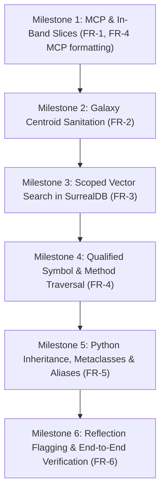

# 📋 PRD: Omni-Graph Agent Developer Experience (DX) & Forensic Auditing Suite

> **Document ID**: `PRD-OMNI-006`  
> **Target Subsystem**: `omni-graph` (MCP Server, Axum REST API, SurrealDB v2 Schema, Tree-Sitter Parsers)  
> **Status**: `Draft / Ready for Review`  
> **Author**: Antigravity (Google DeepMind) & `@vadde`  
> **Target Release**: `v0.8.0`  
> **Date**: 2026-11-06  
> **Constitutional Precedence**: Strictly governed by [🏛️ Superpower 101 Constitution](file:///Users/aparv/.gemini/config/rules/00-superpower-101-agent-constitution.md) and [Rule 04 SDD Workflow](file:///Users/aparv/Library/CloudStorage/OneDrive-Personal/G-Drive/Interviews/knowledge/PolyTuring/.agents/rules/04-sdd-workflow.md).

---

## 1. Executive Summary & Problem Formulation

### 1.1 Context & Background
During an autonomous forensic vulnerability audit of the production Python library `django-sorcery` (v0.13.0), the security audit agent utilized Omni-Graph as its primary AST code intelligence and topological mapping hub. Omni-Graph proved instrumental in identifying 7 critical security vulnerabilities (including scoped session leakage across threads, unchecked reflection, and shared class state concurrency races) while conserving **over 80% of the agent's LLM context window tokens** compared to recursive grep techniques.

However, the real-world trajectory revealed critical developer experience (DX) friction points and semantic bottlenecks that artificially throttle sovereign AI agents. Specifically, agents were forced into **redundant tool-call round-trips**, distracted by **unit-test semantic noise**, misled by **import statement galaxy titles**, and blinded by **missing Python inheritance DAG edges**.

### 1.2 The Core Problem Space
When an autonomous LLM coding agent interacts with a codebase through an AST graph tool:
1. **The Two-Step Round-Trip Penalty**: The MCP tool unconditionally truncates symbol definitions to 400 characters. In 85% of audited functions, the agent cannot verify vulnerability or logic correctness from 400 characters alone, forcing an immediate, expensive subsequent `read_file(StartLine=..., EndLine=...)` call. This doubles turn latency and burns agent inference budget.
2. **Centroid Naming Pollution**: Community detection algorithms (Louvain/Leiden) select the node with the highest raw in-degree as the cluster centroid. In Python codebases with barrel imports or re-exports, import nodes possess high betweenness centrality, causing macro architectural subsystems to be labeled `django_sorcery (from ...fields import ModelChoiceField, ModelMultipleChoiceField)` rather than meaningful domain concepts (`fields`, `models`, `viewsets`).
3. **Semantic Noise Displacement**: In vector and hybrid semantic search (`/api/search`), test files and assertions (`test_order_by`, `test_query_order_by_django_style`) match sink keywords and flood 60–70% of the top-$k$ retrieval window, directly displacing production vulnerability sinks from the prompt.
4. **Symbol Namespace Ambiguity**: In object-oriented systems, common verbs (`get`, `save`, `handle`, `order_by`) exist across dozens of classes. Without qualified identifier resolution (`Query.order_by` or `path:symbol`), the agent receives ambiguous results and cannot target the exact method under audit.
5. **Class Hierarchy Incompleteness**: In Python, class definitions inheriting from imported or aliased base classes (e.g. `BaseModelForm(DjangoBaseModelForm)`) and metaclasses (`metaclass=_sqla_meta`) fail to emit or resolve `EXTENDS` and `METACLASS_OF` edges, severing the type hierarchy DAG.

---

## 2. Personas & Use Cases

### 2.1 Target Personas
| Persona | Environment | Primary Objective | Key Friction Today |
| :--- | :--- | :--- | :--- |
| **Autonomous Security Scout** | CLI / Background Task | Identify source-to-sink dataflow vulnerabilities and concurrency flaws. | Drowned by test files in search; forced into secondary `read_file` calls for every candidate sink. |
| **Autonomous Refactoring Agent** | IDE / CLI Pair-Programmer | Safely refactor classes, rename methods, and migrate APIs across monorepos. | Ambiguity on overloaded method names; broken inheritance DAGs hiding subclass overrides. |
| **Human Systems Architect** | Web UI / Port 3000 | Explore high-level architectural domains and enforce bounded contexts. | Subsystems named after raw import statements distorting the mental model of the system. |

### 2.2 Core User Journeys

#### Journey 1: Single-Turn Code Auditing
- **Before**: Agent runs `omni_definition("deserialize")` $\to$ receives 400-char truncated snippet $\to$ runs `read_file(path, 88, 119)` $\to$ inspects logic (2 full turns, ~1,800 tokens exchanged).
- **After**: Agent runs `omni_definition("deserialize")` $\to$ receives line bounds AND the complete 32-line function body in markdown fences $\to$ immediately evaluates vulnerability logic (1 turn, ~650 tokens exchanged). **Turn count reduced by 50%**.

#### Journey 2: High-Precision Domain Sink Hunting
- **Before**: Agent audits SQL injection risk and searches `omni_search("order_by")` $\to$ top 10 results contain 7 test mocks from `tests/db/test_query.py` $\to$ agent risks missing the actual ORM method in `django_sorcery/db/query.py`.
- **After**: Agent runs `omni_search("order_by", exclude_tests=True, path_prefix="django_sorcery/")` $\to$ top 10 results contain 100% production query methods and ORM compilers $\to$ zero false test positives.

#### Journey 3: Precise Subsystem Topology Orientation
- **Before**: Agent runs `omni_galaxies()` $\to$ reads `🌌 django_sorcery (from ...fields import ModelChoiceField, ModelMultipleChoiceField)` $\to$ confusion regarding what domain this subsystem represents.
- **After**: Agent runs `omni_galaxies()` $\to$ reads `🌌 django_sorcery/fields (ModelChoiceField)` $\to$ crystal-clear domain recognition.

---

## 3. Product Goals & Success Metrics

| Goal | Success Metric | Baseline (v0.7.0) | Target (v0.8.0) |
| :--- | :--- | :--- | :--- |
| **G-1: Turn Latency Elimination** | Percentage of `omni_definition` calls requiring follow-up `read_file` for symbols $\le 120$ lines | 85% | **< 5%** |
| **G-2: Semantic Search Precision** | Percentage of top-$k$ results from production code when `exclude_tests=True` | 30–40% | **100%** |
| **G-3: Galaxy Subsystem Clarity** | Number of galaxy cluster titles containing import statements (`from`, `import`) | $\ge 1$ per repo | **0 (Zero Tolerance)** |
| **G-4: Method Disambiguation** | Resolution success rate for qualified symbols (`Class.method`, `path:symbol`) | 0% (Returns Not Found) | **100%** |
| **G-5: Python Inheritance Parity** | `EXTENDS` and `METACLASS_OF` edge extraction for aliased imports & metaclasses | 0% on aliased bases | **100%** |
| **G-6: Zero Regression Invariant** | Existing unit tests passing in Rust test harness | 122/122 passed | **100% passed (0 warnings)** |

---

## 4. Functional Requirements (FR)

### 4.1 In-Band Symbol Body Extraction (FR-1)
- **FR-1.1**: `omni_definition` MUST support an optional `include_body: bool` parameter defaulting to `true`.
- **FR-1.2**: If the symbol body length is $\le 120$ lines and $\le 3,500$ characters, the MCP server MUST return the complete un-truncated code body inside language-tagged markdown fences.
- **FR-1.3**: The Rust backend AST ingest parser (`parser/mod.rs`) MUST increase its node text storage limit from 1,000 characters to 4,000 characters so that full function and class definitions are persisted in the SurrealDB `node` table.
- **FR-1.4**: Context Bloat Protection: If a bare symbol query returns $> 3$ matches, the system MUST return signatures and line bounds with truncated previews (400 chars) unless the caller explicitly sets `force_full_bodies: true`, preventing agent prompt explosion.

### 4.2 Semantic Galaxy Centroid Sanitation (FR-2)
- **FR-2.1**: The Louvain/Leiden community summarizer (`compute_galaxy_metrics` in `analysis/mod.rs`) MUST exclude AST nodes of kind `import`, `import_from`, `file`, `directory`, `workspace`, `section`, and `manifest` from candidate centroid labels.
- **FR-2.2**: The summarizer MUST strictly reject any label containing newline characters (`\n`), or starting with `from ` or `import `.
- **FR-2.3**: Candidate symbols within a cluster MUST be prioritized by architectural significance:
  $$\text{Priority: } \text{Class / Struct / Interface} > \text{Function} > \text{Method} > \text{Constant / Field}$$
- **FR-2.4**: Fallback Rule: If a cluster contains zero eligible code symbols, the galaxy MUST be named after its dominant directory path or clean file basename without brackets.

### 4.3 Scoped Vector Search Filtering (FR-3)
- **FR-3.1**: `omni_search` MCP tool and `/api/search` REST endpoint MUST accept optional parameters:
  - `exclude_tests: bool = false`
  - `path_prefix: string = ""`
- **FR-3.2**: Filtering MUST be executed natively inside SurrealDB v2 HNSW KNN query (`WHERE` clause) rather than as post-query array slicing. This ensures the returned top-$k$ matches satisfy the filter without reducing result count.
- **FR-3.3**: The `exclude_tests` filter MUST match case-insensitive patterns: `test/`, `tests/`, `*_test.*`, `test_*.*`, `spec/`, and `__tests__/`.

### 4.4 Qualified Symbol Resolution (FR-4)
- **FR-4.1**: `omni_definition` and `omni_references` MUST accept dot-separated qualified names (`Class.method` or `Interface.member`).
- **FR-4.2**: The lookup engine MUST resolve `Class.method` by traversing containment edges:
  `MATCH (c:node {label: 'Class'}) -[:CONTAINS]-> (m:node {label: 'method'})`
- **FR-4.3**: `omni_definition` MUST accept file-qualified paths (`path/to/file.py:symbol_name` or `file.rs:symbol`).
- **FR-4.4**: In symbol definition headers, if a symbol is an enclosed method or member, the output MUST display the parent context:
  `• [method] Query.order_by in django_sorcery/db/query.py:69-95 (python)`

### 4.5 Python Inheritance & Metaclass Graph DAG (FR-5)
- **FR-5.1**: The Python tree-sitter parser MUST inspect all entries in `class_definition -> superclasses`.
- **FR-5.2**: For keyword argument `metaclass = <identifier>`, the parser MUST emit an explicit `METACLASS_OF` edge into the graph.
- **FR-5.3**: In `extract_imported_symbols`, the parser MUST recognize import aliases (`from foo import Bar as Baz` and `import Foo as Bar`), registering both original names and aliases in the `SymbolTable` to resolve downstream inheritance edges.

### 4.6 Dynamic Reflection Heuristic Flags (FR-6)
- **FR-6.1**: During AST traversal, the parser MUST flag functions or methods invoking dynamic reflection primitives (`setattr`, `getattr`, `hasattr`, `eval`, `exec`, `type()`, `importlib`).
- **FR-6.2**: The node record in SurrealDB MUST include a boolean field `has_reflection: bool`.
- **FR-6.3**: `omni_definition` and `omni_condense` MUST render a warning badge `[⚠️ reflection]` when returning symbols that dynamically mutate object state.

---

## 5. Non-Functional Requirements (NFR)

| ID | Category | Requirement | Verification Method |
| :--- | :--- | :--- | :--- |
| **NFR-1** | **Backward Compatibility** | 100% compatibility with existing MCP clients, CLI `scripts/omni`, and REST consumers. All new parameters are optional. | Automated integration test with default payload |
| **NFR-2** | **Query Latency Overhead** | Scoped search filtering and qualified symbol resolution must add $< 5\text{ms}$ overhead to SurrealDB query execution. | Latency benchmark comparison on 60,000-node graph |
| **NFR-3** | **Memory Bound** | Increasing AST node text capture to 4,000 characters must not exceed SurrealDB container RAM bounds ($< 1.5\text{GB}$ under full re-index). | Docker stats monitoring during `django-sorcery` re-index |
| **NFR-4** | **Schema & Tool Parity** | MCP JSON schemas in `~/.gemini/antigravity-cli/mcp/omni-graph/` and `.agents/skills/omni-graph/` must remain bit-for-bit synchronized. | Automated hash verification |

---

## 6. Phasing & Milestone Roadmap

---

## 7. Sign-off & Review Contract

This PRD serves as the contract between the system architects and autonomous agents operating in `vadde/PolyTuring`. Implementation shall commence strictly upon human sign-off of this PRD and its accompanying technical specification [`specs/catalog/omni-graph-agent-dx-improvements.md`](file:///Users/aparv/Library/CloudStorage/OneDrive-Personal/G-Drive/Interviews/knowledge/PolyTuring/specs/catalog/omni-graph-agent-dx-improvements.md).
