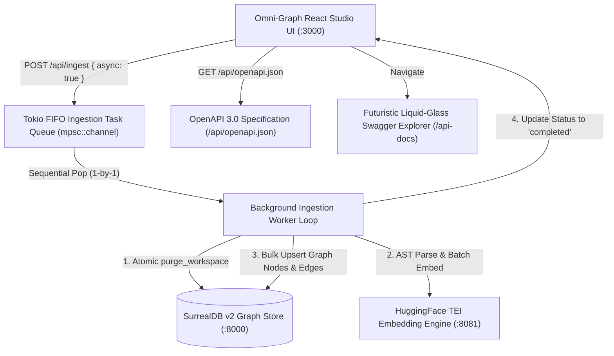

# 📋 Spec: Omni-Graph Ingestion Queue, UX Modernization & OpenAPI 3.0 Explorer

> **Tool**: `omni-graph`  
> **Status**: `in-progress`  
> **Target Release**: `v0.4.0`  
> **Author**: PolyTuring Engineering & Antigravity Pair  
> **Last Updated**: 2026-11-04  

---

## 1. Executive Summary & Problem Statement

### Problem Formulation
1. **Unchecked Concurrency & SurrealDB Conflicts**:
   When a user triggered ingestion of a codebase while another ingestion was active, the backend attempted concurrent SurrealDB transactions and simultaneous HuggingFace TEI embedding batches. This caused SurrealDB v2 transaction write conflicts (`Failed to commit transaction due to a read or write conflict`), unhandled task aborts, and stuck tasks that perpetually remained in `phase: "indexing"` with `completed: false`.
2. **Cognitive Overhead in UI ("Clean Re-ingest")**:
   The "Clean Re-ingest — purge existing data before scan" checkbox presented false choice and confusion. In graph retrieval systems, re-ingesting a repository must de facto purge stale records to avoid orphan nodes, shifted AST line ranges, and ghost references.
3. **Confusing Button & Queue States**:
   When any ingestion was running, the UI switched buttons globally to disabled `"Ingesting..."`, preventing users from browsing or queueing subsequent codebases.
4. **Missing Enterprise OpenAPI 3.0 Documentation**:
   Omni-Graph exposes 28+ specialized AST, semantic, galaxy clustering, and graph endpoints, but lacked a browsable OpenAPI 3.0 specification and interactive Swagger/Explorer matching PolyTuring's cosmic liquid-glass aesthetic.
5. **Route & State Loss on Browser Refresh**:
   Navigating between 3D Graph, Analytics, and API Docs lost state on browser reload or deep-linking.

---

## 2. Architecture & Design Principles

---

## 3. Detailed Requirements & Traceability Matrix

### Ingestion & FIFO Concurrency (`R-001` - `R-004`)
- **`R-001` (Serialized FIFO Task Queue)**: The Rust orchestrator shall implement a dedicated Tokio `mpsc::channel` FIFO queue for repository ingestion tasks. All database writes and embedding requests shall execute sequentially.
- **`R-002` (Non-Blocking Asynchronous Enqueueing)**: `POST /api/ingest` shall support `{ "async": true }` to return immediately (`202 Accepted`) with `{ "status": "queued", "queue_position": N }` or `{ "status": "running", "queue_position": 0 }`.
- **`R-003` (Atomic Clean Invariant)**: Ingestion shall automatically purge existing workspace records in SurrealDB (`db.purge_workspace(workspace_name)`) before re-indexing. The manual "Clean Re-ingest" checkbox shall be removed from the UI.
- **`R-004` (Deterministic Lifecycle & Error Trapping)**: Any error during scan, AST extraction, or embedding shall deterministically transition the job status to `phase: "failed"`, `completed: true`, and populate `error: Some(err_msg)` to prevent zombie jobs.

### UX & Directory Ingestion Palette (`R-005` - `R-008`)
- **`R-005` (Non-Blocking Multi-Repo Action Buttons)**: The "Select Codebase to Ingest" modal shall never disable directory rows or action buttons with a global `"Ingesting..."` label. If another codebase is running, buttons shall clearly display `+ Add to Queue` or `Queue`.
- **`R-006` (Directory List Status Badges)**: Each directory row shall indicate its real-time state:
  - If indexing: `● Ingesting (${files} files)`
  - If queued: `⌛ Queued #${position}`
  - If indexed: `✓ Indexed (${symbols} symbols)`
- **`R-007` (Persistent HUD Queue Telemetry)**: The bottom Ingestion HUD shall display real-time queue position badges (`QUEUED #1`, `QUEUED #2`) and descriptive phase messages (`Purging stale records...`, `Scanning...`, `Indexing...`).
- **`R-008` (Modal Resiliency & Dismissal)**: The Ingestion Modal backdrop and close (`X`) buttons shall remain clickable and responsive at all times, even while an ingestion is running.

### OpenAPI 3.0 & Futuristic Swagger Explorer (`R-009` - `R-012`)
- **`R-009` (Comprehensive OpenAPI 3.0 Specification)**: The backend shall serve a valid OpenAPI 3.0.3 specification at `GET /api/openapi.json` covering all 28+ Omni-Graph endpoints.
- **`R-010` (Cosmic Liquid-Glass API Explorer UI)**: Omni-Graph UI shall provide an interactive API Explorer at `/api-docs` styled with Year 2500 liquid glass, backdrop blur, tag category filters, parameter inputs, and a live "Try It Live" execution console.
- **`R-011` (Top Bar Navigation Integration)**: A prominent `{ } API Spec (OpenAPI 3.0)` button shall be integrated into the top navigation bar at `http://localhost:3000/`.
- **`R-012` (Enterprise Client Routing & State Persistence)**: The UI shall support HTML5 history routing (`/`, `/graph`, `/analytics`, `/api-docs`, `/ingest`) that survives hard browser refreshes (`F5`), browser Back/Forward (`popstate`), and preserves `?workspace=...` query parameters.

---

## 4. Test Harness & Acceptance Verification

| Requirement | Test Scenario | Acceptance Criteria |
| :--- | :--- | :--- |
| `R-001`, `R-002` | Enqueue 2 codebases back-to-back (`POST /api/ingest { async: true }`) | Job 1 starts immediately (`queue_position: 0`); Job 2 queues (`queue_position: 1`). SurrealDB reports zero transaction conflicts. |
| `R-003` | Re-ingest an already indexed workspace | Previous symbols are purged before re-indexing; symbol count precisely matches fresh codebase. |
| `R-004` | Attempt ingestion on invalid path | Status transitions to `phase: "failed"`, `completed: true`, error is human-readable. |
| `R-005`, `R-006` | Browse directories in UI while ingestion is active | Action buttons display `+ Add to Queue` and directory rows display live status badges. |
| `R-008` | Click backdrop or `X` during ingestion | Modal closes smoothly without interrupting background queue. |
| `R-009`, `R-010` | Navigate to `/api-docs` and click "Try It Live" on `/api/health` | Renders liquid-glass explorer, executes query, returns HTTP 200 with latency timing. |
| `R-011`, `R-012` | Hard browser refresh on `http://localhost:3000/api-docs?workspace=PolyTuring` | Page directly renders API Spec with `PolyTuring` workspace preserved; no 404. |

---

## 5. Implementation Status

- [x] Backend FIFO Ingestion Queue (`src/ingestion/mod.rs`)
- [x] Deterministic Error Trapping & Purge Invariant (`src/ingestion/mod.rs`)
- [x] OpenAPI 3.0 Specification JSON (`src/api/openapi.json`)
- [x] OpenAPI Backend Route (`src/api/mod.rs`)
- [x] Liquid Glass Swagger Explorer (`ui/src/ApiSpecExplorer.tsx`)
- [x] Top Navigation Header Button & View Switcher (`ui/src/App.tsx`)
- [x] Directory Palette Status Badges & Queue Actions (`ui/src/App.tsx`)
- [x] Modal Footer State Simplification & Clean Guarantee Banner (`ui/src/App.tsx`)
- [x] Ingestion HUD Queue Badges (`ui/src/App.tsx`)
