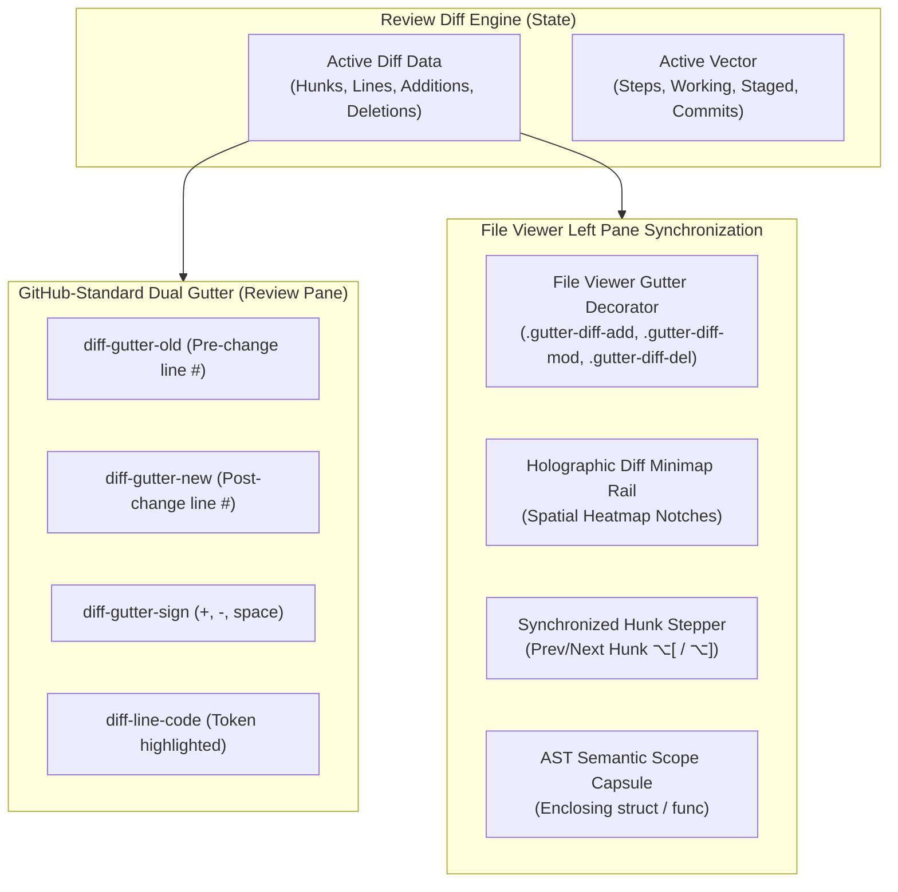

# 📐 SDD Specification — Diff Spatial Sync, Dual Line Numbers & In-File Change Intelligence

**Tool**: `session-explorer`  
**Feature**: Diff Spatial Sync, GitHub-Standard Dual Line Numbers, In-File Gutter Decorations & Minimap Rail  
**Date**: 2026-11-09  
**Author**: Antigravity  
**Status**: `spec-review`  
**Constitutional Compliance**: Superpower 101 Constitution (Rule 101) & Spec-Driven Development (Rule 04)

---

## 1. Architectural Overview

This specification establishes the technical implementation contract for bidirectional diff synchronization, GitHub-standard dual line number gutters, in-file code viewer diff decorations, ambient spatial minimap rails, synchronized hunk stepping, and AST semantic scope detection in `session-explorer`.



---

## 2. Requirement Specifications (R-061..R-066)

### R-061: GitHub-Standard Dual Line Number Gutter
1. In Unified Diff mode, every diff line row MUST render two dedicated gutter number slots:
   - `<span class="diff-gutter-num diff-gutter-old">`: Old line number from base file; empty string if `line.type === 'add'`.
   - `<span class="diff-gutter-num diff-gutter-new">`: New line number in head file; empty string if `line.type === 'delete'`.
   - `<span class="diff-gutter-sign">`: `+`, `-`, or ` ` (space).
   - `<span class="diff-line-code">`: Syntax-tokenized code line.
2. Context lines MUST display matching old and new line numbers.
3. In Split Diff mode, the left pane line displays the old line number; the right pane line displays the new line number.
4. Gutter numbers MUST utilize `font-variant-numeric: tabular-nums` and a fixed width of `3.2rem` per column to ensure character grid stability.

### R-062: In-File Code Gutter Diff Decorations
1. The left file viewer's line number gutter (`#fileViewerLineNumbers`) MUST dynamically annotate lines that correspond to the active diff:
   - Added lines: Add class `.gutter-diff-add` with a high-contrast green left-border (`#10b981`) and subtle glow.
   - Modified lines: Add class `.gutter-diff-mod` with a cyan/blue left-border (`#38bdf8`).
   - Deletions: Insert an ambient deletion indicator `.gutter-diff-del` on the line immediately preceding or following the deleted range with a rose marker (`#f43f5e`).
2. Gutter decorations MUST automatically update when switching review vectors (`⚡ Agent Steps`, `📝 Working Copy`, `📦 Staged`, `📜 Commits`) and when scrubbing agent steps.
3. When the review pane is closed or clean, all in-file diff decorations MUST clear with zero residual DOM footprint.

### R-063: Holographic Diff Minimap Rail
1. A slim vertical heatmap strip (`.file-diff-minimap-rail`, 4px wide) MUST be mounted on the right boundary of the file viewer code viewport.
2. For each diff hunk, the engine maps line positions to percentage coordinates:
   $$\text{top} = \left(\frac{\text{targetLine}}{\text{totalLines}}\right) \times 100\%$$
3. Renders glowing neon ticks:
   - Green ticks for additions.
   - Rose ticks for deletions.
   - Cyan ticks for modifications.
4. Clicking any notch on the minimap rail smoothly scrolls the file viewer and review pane directly to that line.

### R-064: Synchronized Hunk Stepper Navigation
1. The review topbar and floating HUD MUST provide:
   - `⏮ Prev Hunk` button (`⌥[` or `F7`).
   - `⏭ Next Hunk` button (`⌥]` or `F8`).
   - Position indicator: `Hunk X of Y`.
2. Stepping to a hunk MUST:
   - Smoothly scroll the review pane to the target hunk header.
   - Smoothly scroll the left file viewer pane to center the target line.
   - Trigger a pulsating highlight (`jump-pulse`) on both panes for 1.6s.

### R-065: AST Semantic Scope Breadcrumbs
1. Hunk headers (`@@ -old,len +new,len @@ [scope]`) frequently include trailing symbol context (e.g., `@@ -484,4 +484,92 @@ type SessionAgentContext struct {`).
2. The engine MUST parse this trailing context and render an interactive **AST Scope Capsule**:
   - Displays symbol type icon (`📦` for struct/class, `⚡` for func/method, `⚙️` for config).
   - Cleanly formats the signature name without raw regex noise.
   - If no symbol exists in the header, falls back to line range representation.

### R-066: Surgical Hunk Patch Copy & Desktop IDE Deep-Linking
1. Each hunk card header MUST provide an individual `📋 Hunk` button that copies only that specific hunk as a valid unified diff patch.
2. The file viewer topbar MUST provide an `↗ IDE` dropdown or button generating:
   - `vscode://file/<absolute_path>:<line>`
   - `cursor://file/<absolute_path>:<line>`
3. Allows 1-click launching into desktop editors at the exact line of interest.

---

## 3. Data Structures & State Additions

### Client State Additions (`state`)
```javascript
state.reviewActiveHunkIndex = 0;       // Current active hunk index (0-indexed)
state.reviewHunkCount = 0;             // Total hunks in active diff
state.fileGutterDecorations = new Map();// Map<lineNum, 'add'|'mod'|'del'>
state.fileMinimapMarkers = [];         // Array<{lineNum, type, percent}>
```

---

## 4. Acceptance Criteria (AC-143..AC-165)

| ID | Criteria Description | Target Requirement |
| :--- | :--- | :---: |
| **AC-143** | Unified diff rows render two distinct gutter columns (`diff-gutter-old` and `diff-gutter-new`) | R-061 |
| **AC-144** | On additions, `diff-gutter-old` is blank and `diff-gutter-new` renders the line number | R-061 |
| **AC-145** | On deletions, `diff-gutter-new` is blank and `diff-gutter-old` renders the line number | R-061 |
| **AC-146** | On context lines, both old and new columns render their respective numbers | R-061 |
| **AC-147** | Numbers in gutters use tabular numeric alignment without horizontal jitter | R-061 |
| **AC-148** | When a diff is rendered, the left file viewer gutter receives `.gutter-diff-add` for added lines | R-062 |
| **AC-149** | When a diff is rendered, modified lines receive `.gutter-diff-mod` | R-062 |
| **AC-150** | Deletion points render a rose marker `.gutter-diff-del` indicating insertion coordinates | R-062 |
| **AC-151** | Switching vectors (`⚡ Agent Steps` $\to$ `📝 Working Copy`) re-calculates file gutter decorations | R-062 |
| **AC-152** | Closing review pane or viewing a clean file removes all in-file diff decorations | R-062 |
| **AC-153** | Clicking a gutter decoration in the file viewer scrolls the review pane to that hunk | R-062 |
| **AC-154** | The vertical `.file-diff-minimap-rail` renders color-coded ticks corresponding to changed lines | R-063 |
| **AC-155** | Minimap ticks are calculated via percentage coordinates based on total file line count | R-063 |
| **AC-156** | Clicking a minimap tick smoothly scrolls the file viewer to that line | R-063 |
| **AC-157** | Topbar renders `⏮ Prev Hunk` and `⏭ Next Hunk` buttons and `Hunk X of Y` indicator | R-064 |
| **AC-158** | Keyboard shortcuts `⌥[` and `⌥]` trigger previous and next hunk stepping | R-064 |
| **AC-159** | Stepping to a hunk simultaneously centers both the review hunk and the file viewer line | R-064 |
| **AC-160** | Both target elements display a temporary animated cosmic pulse aura (`jump-pulse`) | R-064 |
| **AC-161** | Trailing symbol contexts in hunk headers are parsed into AST Scope Capsules | R-065 |
| **AC-162** | AST capsules display appropriate glyphs (`📦` struct, `⚡` func) | R-065 |
| **AC-163** | Each hunk header renders an individual `📋 Hunk` button | R-066 |
| **AC-164** | Clicking `📋 Hunk` copies only that specific hunk as a valid unified diff patch | R-066 |
| **AC-165** | `↗ IDE` action generates functional `vscode://` and `cursor://` deep links | R-066 |

---

## 5. Visual Aesthetics & Styling Specifications

### 5.1 Dual Gutter Layout
```css
.diff-gutter-num {
  font-family: var(--font-mono);
  font-size: 0.75rem;
  font-variant-numeric: tabular-nums;
  min-width: 3.2rem;
  text-align: right;
  padding: 0 0.5rem;
  color: var(--text-tertiary);
  user-select: none;
}
.diff-gutter-old {
  border-right: 1px solid rgba(255, 255, 255, 0.04);
}
.diff-gutter-new {
  border-right: 1px solid rgba(255, 255, 255, 0.04);
}
```

### 5.2 Gutter Diff Decorations (File Viewer)
```css
.file-viewer-line-numbers span.gutter-diff-add {
  border-left: 3px solid #10b981;
  background: rgba(16, 185, 129, 0.12);
  color: #a7f3d0;
  font-weight: 600;
}
.file-viewer-line-numbers span.gutter-diff-mod {
  border-left: 3px solid #38bdf8;
  background: rgba(56, 189, 248, 0.12);
  color: #bae6fd;
}
.file-viewer-line-numbers span.gutter-diff-del {
  border-bottom: 2px solid #f43f5e;
  position: relative;
}
.file-viewer-line-numbers span.gutter-diff-del::after {
  content: '▾';
  position: absolute;
  left: 1px;
  color: #f43f5e;
  font-size: 0.7rem;
}
```

### 5.3 Minimap Rail
```css
.file-diff-minimap-rail {
  position: absolute;
  top: 0;
  right: 0;
  width: 4px;
  height: 100%;
  background: rgba(0, 0, 0, 0.2);
  z-index: 10;
  pointer-events: auto;
  cursor: pointer;
}
.minimap-tick {
  position: absolute;
  left: 0;
  width: 100%;
  height: 2px;
  border-radius: 1px;
}
.minimap-tick-add { background: #10b981; box-shadow: 0 0 4px #10b981; }
.minimap-tick-mod { background: #38bdf8; box-shadow: 0 0 4px #38bdf8; }
.minimap-tick-del { background: #f43f5e; box-shadow: 0 0 4px #f43f5e; }
```
