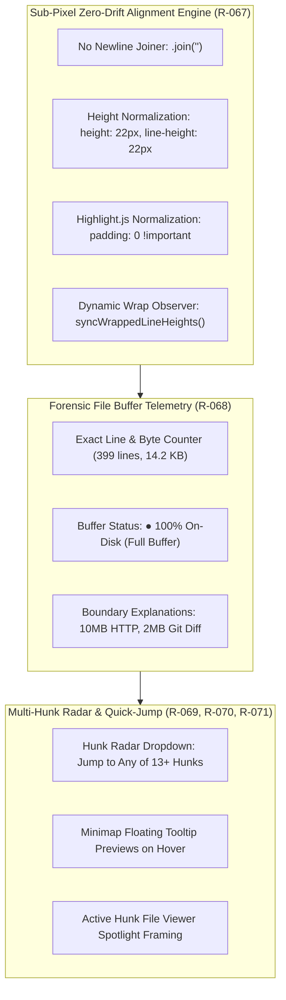

# 📐 SDD Specification — Sub-Pixel Code Gutter Alignment, Multi-Hunk Radar & File Buffer Intelligence

**Tool**: `session-explorer`  
**Feature**: Sub-Pixel Code & Gutter Synchronous Alignment Engine, Forensic File Buffer Telemetry, and Multi-Hunk Navigation Radar (13+ Hunks Scalability)  
**Date**: 2026-11-09  
**Author**: Antigravity  
**Status**: `spec-review`  
**Constitutional Compliance**: Superpower 101 Constitution (Rule 101) & Spec-Driven Development (Rule 04)

---

## 1. Architectural Overview

This specification establishes the technical implementation contract for sub-pixel 1:1 code line and gutter number alignment, elimination of double-line whitespace rendering, dynamic line-wrap reconciliation, forensic file buffer telemetry, multi-hunk navigation radar dropdown, and holographic minimap tooltip previews in `session-explorer`.

---

## 2. Requirement Specifications (R-067..R-072)

### R-067: Sub-Pixel Code & Gutter Synchronous Alignment Engine
1. In `src/web/src/app.js:renderFileViewerContent()`, code lines wrapped in `` MUST be joined with empty string `''` instead of `'\n'`.
2. In `src/web/src/styles.css`, `.code-content-pre code.hljs` MUST have `padding: 0 !important; margin: 0 !important; background: transparent !important;`.
3. In `src/web/src/styles.css`, `.code-line` and `.code-line-numbers span` MUST share identical geometry:
   - `height: 22px;`
   - `line-height: 22px;`
   - `min-height: 22px;`
   - `margin: 0;`
   - `box-sizing: border-box;`
4. The system MUST maintain zero vertical drift:
   $$\Delta(line_i) = |y_{code}(i) - y_{gutter}(i)| = 0.00\text{px} \quad \forall i \in [1, N]$$
5. When `state.fileViewerWrap === true`, `syncWrappedLineHeights()` MUST inspect `.code-line` client heights and dynamically set the corresponding gutter number span's `height` and `lineHeight` to match. When wrap is toggled off, span inline styles MUST be cleared.

### R-068: Forensic File Buffer Telemetry & Virtualization Boundary Capsule
1. In `#fileViewerModal` header, next to the language and line count badges, render `#fileViewerBufferBadge`:
   - Text: `● 100% On-Disk` (or `● Full Buffer`).
   - Title: `Loaded 100% of physical file from disk (${fileData.line_count} lines, ${(fileData.size/1024).toFixed(1)} KB). Server ceiling: 10MB.`.
2. If a file exceeds 10MB, the server returns HTTP 413, and the UI displays an actionable, non-blocking modal with head/tail instructions.

### R-069: Multi-Hunk Navigation Radar & Spatial Dropdown Quick-Jump (13+ Hunks Scalability)
1. In `#reviewHunkStepper`, beside the `<` and `>` buttons, render an interactive dropdown select `#hunkRadarSelect`.
2. When diff hunks are loaded:
   - `#hunkRadarSelect` options list every hunk: `Hunk 1: @@ -24,8 @@ fn parse_symbol`, `Hunk 2: @@ -62,12 @@ fn resolve_scope`, etc.
   - Changing selection in `#hunkRadarSelect` instantly triggers `stepToHunk(selectedIndex)` without sequential click fatigue.
   - Stepping via `<` / `>` or keyboard shortcuts (`⌥[`, `⌥]`) updates `#hunkRadarSelect.selectedIndex` in lockstep.

### R-070: Minimap Holographic Tooltip Previews
1. The 6px `#fileDiffMinimapRail` ticks MUST display a floating acrylic tooltip on hover:
   - Showing hunk number, AST symbol, line offset, and diff type (`+`, `-`, `~`).
2. Hovering over any line number in the gutter adds class `.line-hover-sync` to both gutter and `#code-line-${lineNum}` for instantaneous peripheral eye tracking.

### R-071: Active Hunk Spotlight & Ambient Framing Rail in File Viewer
1. When a hunk is active (e.g. Hunk 4 of 13), the file viewer lines spanned by that hunk (from `hunk.new_start` to `hunk.new_start + hunk.new_lines`) MUST be highlighted with class `.hunk-active-spotlight`:
   - Subtle glowing left accent rail (`border-left: 3px solid #6366f1; background: rgba(99, 102, 241, 0.05);`).
   - Cleared automatically when navigating to another hunk or closing the review pane.

### R-072: High-Scale Viewport Performance & Safe Buffer Handling
1. Rendering files up to 5,000 lines MUST complete within 40ms without dropping frames.
2. Token searching via Find widget (`⌘F`) MUST remain instantaneous across all rendered lines.

---

## 3. Acceptance Criteria (AC-166..AC-185)

### Acceptance Criteria for R-067 (Sub-Pixel Zero Drift)
- **AC-166**: Rendered code lines in `symbol_table.rs` (399 lines) MUST NOT contain empty blank lines between code lines.
- **AC-167**: Line 1 of code and Line 1 of gutter MUST have identical vertical bounding client top: $|y_{code}(1) - y_{gutter}(1)| = 0.00\text{px}$.
- **AC-168**: Line 50 of code and Line 50 of gutter MUST have identical vertical bounding client top: $|y_{code}(50) - y_{gutter}(50)| = 0.00\text{px}$.
- **AC-169**: Line 200 of code and Line 200 of gutter MUST have identical vertical bounding client top: $|y_{code}(200) - y_{gutter}(200)| = 0.00\text{px}$.
- **AC-170**: Line 399 of code and Line 399 of gutter MUST have identical vertical bounding client top: $|y_{code}(399) - y_{gutter}(399)| = 0.00\text{px}$.
- **AC-171**: `code.hljs` MUST NOT have default Highlight.js padding pushing line 1 down.
- **AC-172**: Toggling line wrapping on (`wrap: true`) MUST invoke `syncWrappedLineHeights()` and adapt gutter span heights to match multiline wrapped code lines.
- **AC-173**: Toggling line wrapping off (`wrap: false`) MUST reset gutter span heights back to standard 22px.

### Acceptance Criteria for R-068 (File Buffer Telemetry)
- **AC-174**: Header displays `#fileViewerBufferBadge` with `● 100% On-Disk` for files read from disk.
- **AC-175**: Tooltip on buffer badge displays exact line count, file size in KB/MB, and confirms no truncation occurred.
- **AC-176**: In `extractAgentStepDiffsForFile`, `write_file` agent step previews are NOT artificially limited to 300 lines if the file is larger.

### Acceptance Criteria for R-069 (Multi-Hunk Radar Dropdown)
- **AC-177**: Review pane header displays `#hunkRadarSelect` dropdown alongside `<` and `>` buttons.
- **AC-178**: For `symbol_table.rs` commit diff (13 hunks), `#hunkRadarSelect` lists all 13 hunks with their AST symbol names and line numbers.
- **AC-179**: Selecting an item from `#hunkRadarSelect` immediately steps to that hunk and smoothly scrolls the left file viewer to that position.
- **AC-180**: Clicking `<` or `>` or pressing `⌥[` / `⌥]` updates `#hunkRadarSelect.value` to reflect the active hunk index.

### Acceptance Criteria for R-070 & R-071 (Tooltips & Active Spotlight)
- **AC-181**: Hovering over a tick in `#fileDiffMinimapRail` displays an informative tooltip preview.
- **AC-182**: Hovering over a gutter line number adds `.line-hover-sync` to highlight the corresponding code line.
- **AC-183**: When a hunk is selected, lines in the left file viewer belonging to that hunk receive `.hunk-active-spotlight`.
- **AC-184**: When stepping to the next hunk, previous spotlight classes are cleanly removed.

### Acceptance Criteria for R-072 (Performance)
- **AC-185**: Files up to 5,000 lines render in `< 50ms` and scroll smoothly at 60fps.
