# 📐 Specification: Spatial Auto-Lock, Sticky Zero-Drift Gutter, & Holographic Multi-IDE Cockpit

> **Document ID**: `SPEC-SE-008`  
> **Target Subsystem**: `tools/session-explorer`  
> **Lifecycle Phase**: `spec-review`  
> **Author**: Antigravity Autonomous Agent & Systems Architect  
> **Date**: 2026-11-10  
> **Companion PRD**: [`specs/catalog/session-explorer-spatial-autolock-and-ide-cockpit-prd.md`](session-explorer-spatial-autolock-and-ide-cockpit-prd.md)  
> **Version Target**: `v0.5.3`

---

## 1. Architectural Overview & Context

This specification defines the implementation contract for three interlocking enhancements in Session Explorer:
1. **Spatial Auto-Lock & Framing**: Synchronized bidirectional centering between step scrubbers, diff hunks, and full file contents.
2. **Sub-Pixel Sticky Zero-Drift Gutter**: Viewport-anchored line numbers and diff minimap rail during horizontal code scroll.
3. **Holographic Multi-IDE Selector Cockpit**: Dual-vector desktop IDE integration via Go backend CLI process execution and browser protocol fallback.

```mermaid
flowchart TD
    subgraph Step Scrubber Pipeline
        S1["User navigates step (◀/▶, ArrowKeys, Tab)"] --> S2["stepReviewScrubber(delta)"]
        S2 --> S3["renderStepsVector()"]
        S3 --> S4["renderDiffSurface()"]
        S4 -->|Auto-Sync| S5["stepToHunk(0)"]
        S5 --> S6["File Viewer: Smooth scroll to start line"]
        S5 --> S7["File Viewer: Apply .hunk-active-spotlight"]
        S5 --> S8["File Viewer: Trigger radiant beam pulse"]
        S5 --> S9["Diff Pane: Scroll & Highlight Hunk 1"]
        S5 --> S10["Update state.fileViewerTargetLine"]
    end

    subgraph Sticky Gutter Engine
        G1["User scrolls horizontally (scrollLeft > 0)"] --> G2[".code-line-numbers { position: sticky; left: 0 }"]
        G2 --> G3["Pinned Line Numbers & Gutter Diff Indicators"]
        G1 --> G4[".file-diff-minimap-rail { position: sticky; right: 0 }"]
        G4 --> G5["Pinned Heatmap Rail at Viewport Edge"]
    end

    subgraph Dual-Vector IDE Dispatcher
        I1["User clicks IDE button / picks editor"] --> I2{"Invoke Backend API"}
        I2 -->|POST /api/ide/open| I3["exec.Command(binary, args...)"]
        I3 -->|Binary Found & Executed| I4["Instant Launch (Zero Browser Prompt)"]
        I3 -->|Binary Not Found / Remote| I5["Fallback: window.open(protocolUri)"]
        I5 -->|Blocked / Unhandled| I6["Fallback: Copy CLI Command to Clipboard"]
    end
```



---

## 2. Requirements & Acceptance Criteria (Traceability Matrix)

| Requirement | Description | Acceptance Criteria |
| :--- | :--- | :--- |
| **R-073** | Automatic Hunk 1 Spatial Auto-Lock & Framing | **AC-186**: When `stepReviewScrubber` runs, `stepToHunk(0)` executes automatically if hunks exist.<br>**AC-187**: The left file viewer smoothly scrolls to the primary hunk start line.<br>**AC-188**: `.hunk-active-spotlight` is added across all lines in the hunk.<br>**AC-189**: The primary line receives `.jump-pulse` radiant beam animation.<br>**AC-190**: `state.fileViewerTargetLine` updates to the active hunk line. |
| **R-074** | Sub-Pixel Sticky Zero-Drift Line Number Gutter | **AC-191**: `.code-line-numbers` has `position: sticky; left: 0; z-index: 10;`.<br>**AC-192**: Opaque, frosted glassmorphic backdrops configured for all 4 themes.<br>**AC-193**: Scrolling horizontally to the right preserves visible line numbers docked to the left edge.<br>**AC-194**: Gutter diff indicators (`.gutter-diff-add`, `.gutter-diff-mod`, `.gutter-diff-del`) remain pinned.<br>**AC-195**: Zero text bleed-through from underlying scrolling code lines. |
| **R-075** | Sticky Viewport Docking for Diff Minimap Heatmap Rail | **AC-196**: `.file-diff-minimap-rail` has `position: sticky; right: 0; z-index: 12;`.<br>**AC-197**: Minimap rail remains pinned to visible right edge of the file viewer body during horizontal scrolling. |
| **R-076** | Holographic Multi-IDE Selector Split-Button & Palette | **AC-198**: Split button rendered with active editor icon/label on left, dropdown chevron on right.<br>**AC-199**: Clicking chevron opens glassmorphic palette listing Cursor, VS Code, Windsurf, JetBrains, Sublime, System.<br>**AC-200**: Selecting an editor updates the active button, launches the editor, and persists to `localStorage('se_preferred_ide')`.<br>**AC-201**: Includes "Copy CLI Command" option with toast feedback. |
| **R-077** | Backend Native Process Launch API (`POST /api/ide/open`) | **AC-202**: Go handler `HandleOpenInIDE` bound to `POST /api/ide/open`.<br>**AC-203**: Validates file path existence and containment.<br>**AC-204**: Dispatches `exec.Command` for supported editor binaries (`cursor`, `code`, `windsurf`, `idea`, `subl`, `open`).<br>**AC-205**: Returns `{ success: true }` or fallback URI / command on binary absence. |
| **R-078** | Test & Verification Suite | **AC-206**: Go unit tests pass in `api_test.go`.<br>**AC-207**: Automated Playwright browser tests verify scrubber auto-framing, sticky gutter, and IDE launcher. |

---

## 3. UI/UX Design & Holographic Tokens

### 3.1 IDE Split-Button Topbar Markup
```html
<div class="ide-split-button-group" id="fileViewerIdeGroup">
  <button class="btn-ghost-sm ide-primary-btn" id="fileViewerIdePrimaryBtn" title="Open in Preferred IDE">
    <span class="ide-icon" id="fileViewerIdeIcon">🚀</span>
    <span class="ide-name" id="fileViewerIdeName">Cursor</span>
  </button>
  <button class="btn-ghost-sm ide-dropdown-btn" id="fileViewerIdeDropdownBtn" title="Choose Editor (Cursor, VS Code, Windsurf, JetBrains, Sublime)">
    ▾
  </button>
  <div class="ide-picker-menu holo-glassmorphic-menu" id="fileViewerIdeMenu" style="display: none;">
    <div class="ide-menu-header">Select Desktop IDE</div>
    <div class="ide-menu-item" data-editor="cursor">
      <span class="ide-menu-icon">🚀</span>
      <span class="ide-menu-label">Cursor</span>
      <span class="ide-menu-badge">Default</span>
    </div>
    <div class="ide-menu-item" data-editor="vscode">
      <span class="ide-menu-icon">💙</span>
      <span class="ide-menu-label">Visual Studio Code</span>
    </div>
    <div class="ide-menu-item" data-editor="windsurf">
      <span class="ide-menu-icon">🌊</span>
      <span class="ide-menu-label">Windsurf</span>
    </div>
    <div class="ide-menu-item" data-editor="idea">
      <span class="ide-menu-icon">🧠</span>
      <span class="ide-menu-label">JetBrains (IDEA / PyCharm / GoLand)</span>
    </div>
    <div class="ide-menu-item" data-editor="sublime">
      <span class="ide-menu-icon">📜</span>
      <span class="ide-menu-label">Sublime Text</span>
    </div>
    <div class="ide-menu-item" data-editor="system">
      <span class="ide-menu-icon">🍎</span>
      <span class="ide-menu-label">System Default</span>
    </div>
    <div class="ide-menu-divider"></div>
    <div class="ide-menu-item ide-menu-copy" id="ideMenuCopyCliBtn">
      <span class="ide-menu-icon">📋</span>
      <span class="ide-menu-label">Copy CLI Launch Command</span>
    </div>
  </div>
</div>
```

### 3.2 4-Theme Sticky Gutter Tokens
```css
/* Liquid Glass (Dark Default) */
.code-line-numbers {
  position: sticky;
  left: 0;
  z-index: 10;
  background: rgba(11, 15, 25, 0.96);
  backdrop-filter: blur(16px);
  -webkit-backdrop-filter: blur(16px);
  border-right: 1px solid var(--border-glass);
  box-shadow: 4px 0 16px rgba(0, 0, 0, 0.45);
}

/* Fluent Aero Mica */
[data-theme="mica"] .code-line-numbers {
  background: rgba(248, 250, 252, 0.96);
  border-right-color: rgba(0, 0, 0, 0.12);
  box-shadow: 4px 0 16px rgba(0, 0, 0, 0.08);
  color: #64748b;
}

/* Holo Cyberpunk */
[data-theme="holo"] .code-line-numbers {
  background: rgba(13, 6, 32, 0.96);
  border-right-color: rgba(236, 72, 153, 0.35);
  box-shadow: 4px 0 20px rgba(236, 72, 153, 0.25);
  color: #f472b6;
}

/* Matrix Obsidian */
[data-theme="matrix"] .code-line-numbers {
  background: rgba(0, 15, 5, 0.96);
  border-right-color: rgba(34, 197, 94, 0.35);
  box-shadow: 4px 0 20px rgba(34, 197, 94, 0.25);
  color: #86efac;
}
```

---

## 4. Backend API Contract (`POST /api/ide/open`)

### Request
```http
POST /api/ide/open HTTP/1.1
Content-Type: application/json

{
  "editor": "vscode",
  "path": "/Users/aparv/.../tools/session-explorer/src/server.go",
  "line": 42
}
```

### Response (Success)
```json
{
  "success": true,
  "message": "Opened file in Visual Studio Code at line 42",
  "editor": "vscode",
  "command": "code -g /Users/aparv/.../tools/session-explorer/src/server.go:42"
}
```

### Response (Fallback / Binary Missing)
```json
{
  "success": false,
  "message": "Editor executable 'code' not found in server PATH",
  "fallback_uri": "vscode://file//Users/aparv/.../tools/session-explorer/src/server.go:42",
  "command": "code -g /Users/aparv/.../tools/session-explorer/src/server.go:42"
}
```
