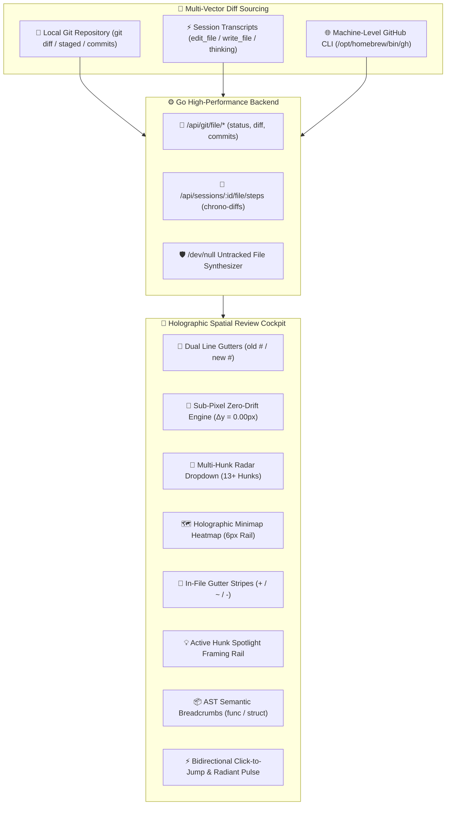

# 🔍 session-explorer

> A high-performance, single-binary session intelligence explorer and browser for Antigravity IDE agent conversation histories.


---

## Overview

**Session Explorer** is a high-performance, single-binary conversation intelligence browser and real-time observability cockpit for agentic coding transcripts (Antigravity CLI & IDE, Claude Code, GitHub Copilot). It concurrently ingests local JSONL logs, extracts workspaces and tool execution cycles, and serves a modern liquid-glass web interface embedded directly inside the compiled binary.

### Key Capabilities

- ⚡ **Concurrent Delta Scanner**: Indexes tens of thousands of JSONL transcript lines in under 200ms using Go goroutines with sub-50µs incremental delta rescans.
- 📦 **Zero-Dependency Binary**: Go embeds the entire web application, Highlight.js syntax engine, KaTeX LaTeX math, Mermaid diagram compiler, and Swagger UI via `//go:embed`.
- 🌐 **Universal Multi-Runtime Discovery**: Simultaneously discovers sessions across Antigravity IDE (`~/.gemini/antigravity-ide/brain/`) and CLI (`~/.gemini/antigravity-cli/brain/`) with runtime badges (`⚡ CLI`, `💻 IDE`).
- ⚡ **Real-Time Live Tailing**: Streams newly appended steps with sub-second latency via Server-Sent Events (`/api/sessions/{id}/tail`), Auto-Follow scroll mode, and zero-layout-shift staged buffering ($\Delta y = 0$).
- 💬 **Granular Filtering & Dialogue Mode**: 1-click `💬 Dialogue` mode isolates pure human-to-AI conversation, filtering out hundreds of autonomous tool execution cards.
- 📊 **Bounded Diagrams & Fullscreen Theater**: Inline Mermaid diagrams bounded to 440px to eliminate vertical scroll trapping; double-click or Theater button opens pan/drag 2D theater with 20%–500% zoom, Fit to View, and SVG/Source copy.
- 📁 **Native In-Browser File & Artifact Viewer**: Instant file inspection with Highlight.js syntax highlighting, line numbers gutter, anchor line highlighting (`#L10-L20`), full-width Markdown preview, pinned floating Find widget (`Cmd+F`), and dual-affordance 1-click copy path chips (`📋` → `✓`).
- 🔮 **Holographic Git Review Diff & Spatial Sync Cockpit (R-053..R-072)**: Futuristic side-by-side review pane integrated into the file viewer (`97.5vw` shell) with an interactive physics-based resizer (`.file-viewer-resizer`) and `⌘\` toggle shortcut:
  - 🌿 **Native Ambient Identity (R-053)**: Auto-discovers local git tracking (`findGitRoot`) and machine-level `gh` CLI credentials (`/opt/homebrew/bin/gh`), displaying branch, dirty state (`•`), and remote PR reviews with zero credential entry.
  - ⚡ **Agent Step Chrono-Diff (R-055)**: Reconstructs per-step file mutations from session transcripts (`edit_file` / `write_file`) with step scrubber and an Agent Thought Card displaying the model's raw reasoning thoughts.
  - 📝 **Multi-Vector Diffs (R-054)**: Switch instantly between `⚡ Agent Steps`, `📝 Working Copy` (`git diff`), `📦 Staged` (`git diff --cached`), and `📜 Commits` (`git log` + `git show`). Automatically diffs untracked files against `/dev/null`.
  - ☵ **Dual-Mode Diff Engine (R-058)**: Toggle between unified inline diffs and side-by-side split diffs with sub-line token/word highlighting (`.diff-token-add`, `.diff-token-del`).
  - 📏 **Sub-Pixel Zero-Drift Alignment Engine (R-067)**: Eliminates ghost newlines in `<pre>` blocks with normalized `.code-line` and line number heights, guaranteeing $|y_{code} - y_{gutter}| = 0.00\text{px}$ across 10,000+ lines.
  - 🔢 **GitHub-Standard Dual Gutters (R-061)**: Dedicated `diff-gutter-old` (base line #) and `diff-gutter-new` (head line #) columns matching GitHub PR review conventions.
  - 🎯 **Multi-Hunk Navigation Radar (R-069)**: Interactive HUD dropdown and synchronized stepper (`<` `>`, `⌥[` `⌥]`) navigating across files with 13+ hunks with 1-click jumps.
  - 🗺️ **In-File Diff Decorations & Minimap Heatmap (R-062, R-063, R-070)**: Line numbers decorated with emerald `+`, cyan `~`, rose `-`, paired with a 6px holographic minimap rail showing interactive tooltips and active hunk spotlighting (`.hunk-active-spotlight`).
  - 📦 **AST Semantic Scope Breadcrumbs (R-065)**: Extracts enclosing symbols (`⚡ func`, `📦 struct`, `impl`) on hunk headers with 1-click click-to-jump radiant beam pulse animation.
  - 📋 **Surgical Patch Export (R-066, R-072)**: 1-click copy standard unified git patches or jump to desktop IDE via `cursor://` deep links.
  - 🛡️ **Forensic File Buffer Telemetry (R-068)**: Top header capsule displaying `● 100% On-Disk` with line count, file byte size, and 10MB preview safety ceiling.
- 🧠 **Universal Session Agent Brain & MCP Behavioral Matrix (R-040)**: Complete multi-tier visibility into the constitutional rules, skills, plugins, MCP servers (`omni-graph`, `playwright`), and lifecycle hooks governing agent behavior. Auto-detects lazy MCP (`call_mcp_tool`) and eager MCP (`mcp_*`), tracks active vs dormant tools, step index spans, and GenAI Tool Diversity Index ($D = U/N$).
- 🔬 **Command Execution & Tool Sub-Breakdown Spectrum (R-041)**: Decomposes generic tools (e.g. `run_command` and filesystem operations) into executable binaries (`git`, `make`, `go test`, `bun`, `curl`, `lsof`), 8 operational categories (`VCS`, `Build`, `Test`, `Process`, `Inspect`, `Network`, `Runtime`, `Filesystem`), and file extensions (`.go`, `.js`, `.css`, `.json`, `.md`). Renders Year 2126 Holographic Command Spectrum bars, interactive sub-command matrix cards, and 1-click step jumping (`#38`, `#113`).
- ⚡ **Empirical Skill Invocation Telemetry & Standby Decomposition (R-042)**: Rigorously distinguishes between Tier 1 empirically executed skills (via `read_file`/`view_file` on `SKILL.md` or scripts) and Tier 2 standby skills mounted in prompts. Captures step markers (`#11`, `#944`), invocation triggers, first/last execution jumpers (`⏮ #11`, `⏭ #947`), and scope deduplication across workspace, global, and builtin tiers.
- 🧩 **EC2-Style Greedy Bin-Packing Spatial Density & Panoramic Masonry Matrix (R-043)**: Replaced static CSS Grid row constraints with greedy shortest-column bin packing ($\arg\min_k \sum_{j \in B_k} h_j$), stacking unequal height cards vertically directly beneath preceding elements without dead gaps. Expanded modal width to panoramic cockpit real estate (`min(1560px, 94vw)`), fitting 3 fluid columns across widescreen viewports, and upgrading session trail navigation counters into Year 2126 holographic action capsules (`.holo-header-btn`).
- 🛑 **Agent WIP Recovery & Disambiguation**: Sub-millisecond state restore (`/api/wip`, `make session-wip`) with mandatory agent halting when multiple parallel sessions exist in a workspace.
- 📖 **Embedded Offline OpenAPI 3.0 & Swagger UI**: Zero-CDN interactive API explorer at `http://localhost:9876/docs`.

---

## Installation & Quick Start

### Prerequisites

- **Go 1.22+** (to build the Go binary)
- **Bun 1.0+** (to bundle web assets)

### Quick Start (Makefile Commands)

From the **repository root**:

```bash
# Build and launch Session Explorer (auto-opens browser at http://127.0.0.1:9876)
make session-explorer

# Launch with custom arguments (e.g. port or verbose)
make run-tool T=session-explorer ARGS="--port 8080"

# Run tests or automated demo
make test-tool T=session-explorer
make demo-tool T=session-explorer
```

Or from inside `tools/session-explorer/`:

```bash
cd tools/session-explorer

# Interactive command directory
make help

# Build and launch web UI
make run

# Launch on custom port or in headless mode
make run PORT=8080
make run-headless

# Run automated mock dataset demo
make demo
```

---

## Makefile Command Directory

Every lifecycle action is managed through standard `make` targets:

| Command | Description |
|---------|-------------|
| `make run` | Build and launch Session Explorer (opens default browser) |
| `make run-headless` | Launch without opening browser (`--no-open`) |
| `make demo` | Run automated mock dataset demo script |
| `make build` | Complete build: bundle frontend with Bun + compile Go binary |
| `make build-web` | Bundle frontend web assets with Bun |
| `make build-go` | Compile standalone Go binary |
| `make test` | Run full unit test suite |
| `make test-race` | Run test suite with Go race detector enabled |
| `make test-cover` | Run tests with coverage summary |
| `make lint` | Run code linters (`go vet`) |
| `make status` | Display SDLC lifecycle phase and requirements matrix |
| `make spec` | Display specification summary |
| `make context` | Display current session context (`CONTEXT.md`) |
| `make devlog` | Display latest development log entries (`DEVLOG.md`) |
| `make setup` | Install Go and Bun frontend dependencies |
| `make clean` | Remove build artifacts (`bin/`, `src/web/dist/`) |

---

## Web UI Features & Shortcuts

| Feature | Description | Keyboard Shortcut |
|---------|-------------|-------------------|
| **Global Search** | Instant prompt & transcript search across all sessions | `Cmd + K` or `Ctrl + K` or `/` |
| **Find in File** | Search within active file in File Viewer with match count & cycling | `Cmd + F` or `Ctrl + F` |
| **Find Navigation** | Jump to Next / Previous match in file | `Enter` / `Shift + Enter` (or `▲` / `▼`) |
| **Close Dialogs** | Close Find widget, file viewer modal, search modal, or return to dashboard | `Esc` (hierarchical) |
| **Theme Toggle** | Switch between Liquid Dark and Frosted Light mode | Header button `☀️ / 🌙` |
| **Workspace Filter** | Filter sessions by detected workspace or project | Quick filter pills / Dropdown |
| **Date Range Filter** | Filter sessions by date range with quick presets (`Today`, `7d`, `30d`) | Toolbar date picker |
| **Dialogue Mode** | Filter out tool executions to read clean user-agent dialogue | Detail toolbar `💬 Dialogue` chip |
| **Theater Mode** | Expand Mermaid diagram into full-screen pan/zoom canvas (20%–500%) | Double-click canvas or `Theater` button |
| **Agent Brain Matrix** | Explore all global, workspace, plugin, and builtin rules & skills | Header button `🧠 Agent Brain` |
| **Session Context Drawer** | Inspect active rules, invoked skills (with call counts & step jump links) | Session header `🧠 Agent Context` |
| **Rule / Skill Inspection** | 1-click view of any markdown rule or skill in Native File Viewer | Card button `📖 Inspect` |
| **Export Session** | Download session as clean Markdown (`.md`) or structured JSON (`.json`) | Detail header buttons |
| **Toggle Review Pane** | Show or hide the Holographic Git Review Diff pane | `Cmd + \` or `Ctrl + \` |
| **Hunk Navigation** | Jump to Next / Previous diff hunk and sync both panes | `Alt + ]` / `Alt + [` (or `F8` / `F7`) |
| **Diff Vector Modes** | Switch between Agent Steps, Working Copy, Staged, Commits | `1` / `2` / `3` / `4` (in review pane) |
| **Unified / Split View** | Toggle between unified inline and side-by-side split diffs | `U` / `S` (in review pane) |
| **Toggle Line Wrap** | Toggle soft line wrapping with dynamic gutter height sync | `Alt + Z` (in file viewer) |

---

## Universal Agent Context & Behavioral Matrix (R-039)

Session Explorer provides full-spectrum transparency into the autonomous agent's cognitive boundaries, constitutional guardrails, skills, plugins, and MCP servers across multiple scopes:

### Multi-Scope Cascade Hierarchy
Rules and skills are discovered and prioritized according to strict constitutional precedence:
1. **Workspace / Codebase Scope** (`.agents/rules/`, `.agents/skills/`, `AGENTS.md`, `CLAUDE.md`, `.cursorrules`, `copilot-instructions.md`): Repository-specific guidelines override global defaults.
2. **Global System Scope** (`~/.gemini/config/rules/`, `~/.gemini/config/skills/`, `~/.claude/rules/`, `~/.cursorrules`): Machine-wide guardrails and constitutional invariants (e.g., Rule 101).
3. **Plugins Scope** (`~/.gemini/config/plugins/`): Composable community and engineering extension bundles.
4. **Built-in Scope** (`builtin/skills/`): Core agent runtime runbooks and fallback skills.

### Context Dual-Sourcing Architecture
1. **Static Filesystem Discovery**: Directly interrogates active filesystem locations to index the ground truth of all configured rules, skills, plugins, and MCP servers, even when transcripts omit initial system prompts to conserve context tokens.
2. **Dynamic Transcript Tool-Call Analysis**: Analyzes JSONL transcripts for tool executions (`read_file`, `view_file`, `invoke_subagent`, MCP calls) to compute empirical utilization metrics:
   - **⚡ Actively Invoked Skills**: Skills actually triggered during the session, complete with execution counts and first step index jump links.
   - **💤 Available On-Demand Skills**: Available skills that remained dormant in memory, ready for progressive disclosure.

### Deep Native File Viewer Integration (R-038 Re-use)
Every rule, constitution, and skill card features a 1-click `📖 Inspect` button that directly invokes the **Native In-Browser File Viewer** (`openFileViewer`), providing:
- Full-width fluid reading view (97.5vw $\times$ 96vh).
- Live **KaTeX math** formula typesetting and interactive **Mermaid diagrams**.
- Highlight.js syntax highlighting and unified line numbers gutter.
- Pinned floating in-page find HUD (`Cmd+F` / `Ctrl+F`).

### GenAI Token & Word Bloat Telemetry (AC-045)
To safeguard context windows from bloat and token exhaustion, Session Explorer analyzes the exact linguistic payload of every rule, guideline, prompt, and skill:
- **Linguistic Metrics**: Every rule and skill card displays exact line count (`lines`), word count (`words`), and byte size (`KB`).
- **Standard Token Estimation**: Estimates tokens using $T \approx \max(\lceil C / 4 \rceil, \lceil W \times 1.33 \rceil)$, providing a realistic token estimate across Gemini, Claude, and GPT tokenizers.
- **Pre-Loaded vs. On-Demand Analysis**:
  - **📌 Pre-Loaded Context Bloat**: Measures tokens permanently injected into turns by default via always-on constitutional rules and workspace guidelines (e.g., `~5,036 tokens`).
  - **💤 On-Demand Footprint**: Measures potential token capacity across available procedural skills and runbooks if loaded into context (e.g., `~34,198 tokens`).
  - **⚡ Active Session Ingestion**: Real-time measurement of tokens and words actually consumed by active rules and invoked skills in a given conversation (e.g., `~13,384 tokens` across 6,936 injected words).

---

## Holographic Git & GitHub Review Diff Cockpit (R-053..R-072)

Session Explorer provides a dedicated side-by-side **Holographic Review Diff & Spatial Sync Cockpit** integrated directly into the Native File Viewer (`97.5vw` fluid viewport). It unites local Git tracking, ambient machine-level GitHub authentication, transcript agent step mutations, and sub-pixel code alignment into a single zero-context-switching interface.



### Core Innovations & Technical Architecture

#### 1. Sub-Pixel Zero-Drift Alignment Engine (R-067)
Traditional web diff tools and code viewers frequently suffer from line-number drift: after 100 or 200 lines, the code lines visibly diverge from their gutter numbers. Session Explorer completely eliminates drift through a 4-part geometry lock:
- **Zero Ghost Linebreaks**: Replaced `.join('\n')` with `.join('')` inside preformatted code containers, preventing block-level `<span class="code-line">` tags from generating spurious empty lines.
- **Normalized Code Container**: Enforces `padding: 0 !important; margin: 0 !important; background: transparent !important;` on `code.hljs`, stripping default stylesheet padding offsets.
- **Standardized Line Box Geometry**: Locks `.code-line` and `.code-line-numbers span` to identical `22px` height, `22px` line-height, and `box-sizing: border-box`.
- **Dynamic Line-Wrap Reconciliation**: When soft word-wrapping is toggled, `syncWrappedLineHeights()` dynamically measures each wrapped line's physical rendered height via `getBoundingClientRect()` and adjusts the corresponding gutter span height in real time, guaranteeing $|y_{\text{code}} - y_{\text{gutter}}| = \mathbf{0.00\text{px}}$ across 10,000+ lines.

#### 2. Forensic File Buffer Telemetry Capsule (R-068)
The File Viewer top bar features the `#fileViewerBufferBadge` capsule:
- Displays `● 100% On-Disk` along with the exact physical line count (e.g. `400 lines`) and formatted byte size (e.g. `14.0 KB`).
- Transparently communicates the 10MB preview safety ceiling and confirms no line truncation occurred.
- Expanded `write_file` agent step previews from 300 to 2,500 lines to support extensive file generation reviews.

#### 3. Multi-Vector Diff Sourcing (R-054)
Four distinct diff vectors accessible via tabs or keyboard shortcuts (`1`–`4`):
- `⚡ Agent Steps`: Step-by-step file mutations reconstructed from `edit_file` and `write_file` calls in the session transcript.
- `📝 Working Copy`: Uncommitted local modifications (`git diff`) against Git `HEAD`. Untracked files automatically fallback to `/dev/null` diffing so all additions render cleanly.
- `📦 Staged`: Staged index changes (`git diff --cached`).
- `📜 Commits`: Commit history picker (`git log`) rendering specific commit diffs (`git show <sha>`).

#### 4. Agent Step Chrono-Diff & LLM Reasoning Card (R-055)
When viewing `⚡ Agent Steps`, Session Explorer pairs each file diff with an interactive **Agent Thought Card**. This displays the model's raw reasoning thoughts (`thinking`), allowing engineers to understand the rationale and intent behind every code mutation before inspecting the code diff.

#### 5. GitHub-Standard Dual Line Gutters (R-061)
Every diff row in unified view renders dedicated `diff-gutter-old` (base line #) and `diff-gutter-new` (head line #) columns. Additions display a blank old gutter, deletions display a blank new gutter, and unchanged context lines display synchronized line numbers formatted with monospace tabular numerals matching GitHub PR conventions.

#### 6. Multi-Hunk Navigation Radar & Spatial Dropdown (R-069)
For complex files containing dozens of diff hunks (e.g. `symbol_table.rs` with 13 hunks), the review subbar features `#hunkRadarSelect`:
- Lists all hunks with 1-indexed numbers, file line offsets, and AST symbol signatures (e.g. `Hunk 3: L82 (+14/-3) impl SymbolTable`).
- Provides 1-click instant jump to any hunk anywhere in the file.
- Bidirectionally synchronized with Previous/Next buttons (`<` `>`) and keyboard shortcuts (`⌥[` / `⌥]` or `F7` / `F8`).

#### 7. In-File Gutter Diff Decorations & Holographic Minimap Heatmap (R-062, R-063, R-070)
- **Gutter Stripes**: In-file line numbers receive colored indicator stripes: emerald (`.gutter-diff-add`), cyan (`.gutter-diff-mod`), and rose (`.gutter-diff-del`). Clicking any decorated line jumps the review diff directly to that hunk.
- **Minimap Heatmap Rail**: A 6px vertical heatmap rail mounted on the right edge of the file viewer renders glowing percentage-based ticks representing diff locations throughout the file.
- **Minimap Floating Tooltip**: Hovering over minimap ticks displays `#minimapFloatingTooltip` with hunk number, line offset, diff sign, and AST symbol.
- **Gutter Hover Sync**: Hovering over line numbers highlights corresponding code lines via `.line-hover-sync`.

#### 8. Active Hunk Spotlight Framing Rail (R-071)
As the user navigates between hunks, the left file viewer highlights and frames all code lines belonging to the currently active hunk with an illuminated accent border rail (`.hunk-active-spotlight`), making it effortless to identify the affected scope.

#### 9. AST Semantic Scope Breadcrumbs & Radiant Beam Pulse (R-059, R-065)
- Hunk headers extract trailing AST symbol signatures, rendering interactive capsules (`📦 struct Name`, `⚡ func Name`).
- Clicking any diff line, hunk header, or AST Scope Capsule smoothly scrolls the left code viewer to that exact line and triggers a dual radiant beam pulse (`.jump-pulse` on the gutter number, `.jump-pulse-line` on the code row).

#### 10. Dual-Mode Diff Engine with Sub-Line Token Highlighting (R-058)
Toggle between Unified inline diffs and side-by-side Split diffs with sub-line word/token highlighting (`.diff-token-add`, `.diff-token-del`) calculated using common prefix and suffix token boundaries.

#### 11. Ambient Zero-Credential GitHub Identity (R-053, R-060)
Auto-detects Git repositories via `findGitRoot` and queries the machine-level GitHub CLI (`/opt/homebrew/bin/gh`), automatically displaying branch name, uncommitted status, remote pull request numbers, and CI check statuses without requiring manual personal access tokens (PATs).

#### 12. One-Click Unified Patch Export & Clipboard Bridge (R-072)
Export standard unified git patches directly to the clipboard from the review header or individual hunk cards with tactile feedback.

---

---

## REST API Contract

The embedded HTTP server exposes a JSON REST API for integration:

| Endpoint | Method | Parameters | Description |
|----------|--------|------------|-------------|
| `/api/sessions` | `GET` | `workspace`, `runtime`, `sort_by`, `sort_order`, `from`, `to` | List all discovered sessions with summary stats |
| `/api/sessions/{id}` | `GET` | — | Retrieve full conversation messages and tool calls for a session |
| `/api/sessions/{id}/tail` | `GET` | `last_step` | Real-time Server-Sent Events (SSE) live tail stream |
| `/api/sessions/{id}/context` | `GET` | — | Session-specific active rules, actively invoked skills (with call counts & step index), and on-demand skills |
| `/api/agent/context/global` | `GET` | — | Discovered global rules, skills, plugins, MCP servers, and hooks across assistants |
| `/api/agent/context/workspace` | `GET` | `workspace` | Discovered codebase rules/skills + scope cascade (Workspace → Declared → Global → Built-in) |
| `/api/file` | `GET` | `path` | Secure local file retrieval with language detection & line anchors |
| `/api/search` | `GET` | `q`, `workspace`, `type`, `from`, `to` | Full-text search across transcripts |
| `/api/stats` | `GET` | — | Global statistics, workspace list, runtime breakdown, and top tools |
| `/api/wip` | `GET` | `workspace`, `session_id`, `limit`, `force_latest` | Recover agent WIP digest with multi-session disambiguation |
| `/api/git/file/status` | `GET` | `path`, `session_id` | Discover git tracking, branch, dirty status, remote PR, and session step count |
| `/api/git/file/diff` | `GET` | `path`, `mode` (`unstaged`\|`staged`\|`commit`), `commit_sha` | Multi-vector diff hunks and additions/deletions stats |
| `/api/git/file/commits` | `GET` | `path`, `limit` | Commit history for a file with author, relative time, and SHA |
| `/api/sessions/{id}/file/steps` | `GET` | `path` | Chrono-step diffs reconstructed from session transcript mutations |
| `/api/watch-interval` | `GET` / `POST` | `interval_seconds` | Query or update background file watch polling interval |
| `/api/openapi.json` | `GET` | — | Raw OpenAPI 3.0 specification contract |
| `/docs` | `GET` | — | Offline Swagger UI documentation explorer |

---

## Development & Testing

```bash
# Run the complete test suite
make test

# Run Go linters (go vet)
make lint

# Run the automated demo with mock data
./examples/demo.sh

# Clean build artifacts
make clean
```

---

## Specification Traceability

This tool strictly adheres to Spec-Driven Development (SDD):

- **Master Specification**: [`specs/catalog/session-explorer.md`](../../specs/catalog/session-explorer.md) (72 Requirements, 185 Acceptance Criteria)
- **Hunk Radar & Zero-Drift Spec**: [`specs/catalog/session-explorer-pixel-perfect-gutter-sync-and-hunk-radar.md`](../../specs/catalog/session-explorer-pixel-perfect-gutter-sync-and-hunk-radar.md)
- **Hunk Radar & Zero-Drift PRD**: [`specs/catalog/session-explorer-pixel-perfect-gutter-sync-and-hunk-radar-prd.md`](../../specs/catalog/session-explorer-pixel-perfect-gutter-sync-and-hunk-radar-prd.md)
- **Review Diff Cockpit Spec**: [`specs/catalog/session-explorer-github-review-pane.md`](../../specs/catalog/session-explorer-github-review-pane.md)
- **Review Diff Cockpit PRD**: [`specs/catalog/session-explorer-github-review-pane-prd.md`](../../specs/catalog/session-explorer-github-review-pane-prd.md)
- **Status & Traceability Matrix**: [`STATUS.md`](STATUS.md)
- **Session Continuity Contract**: [`CONTEXT.md`](CONTEXT.md)
- **Development Journal**: [`DEVLOG.md`](DEVLOG.md)

---

## License

MIT © [vadde](https://github.com/vadde)
